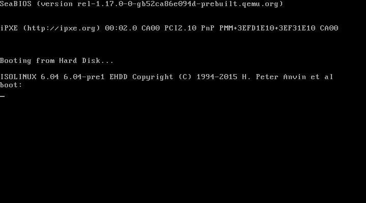
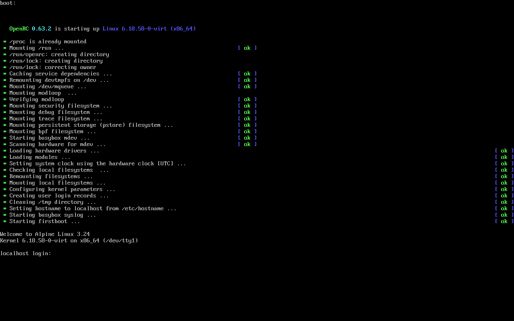

# rufus-linux

A **native Linux backend for the Rufus fork** — no Wine, no Windows binaries.
This is the first working slice of the port: device detection, bootable-image
analysis and a safe raw writer, all in C with no runtime dependencies beyond
libc.

> This directory is part of a GPLv3 fork of [Rufus](https://github.com/pbatard/rufus).
> See `../LINUX-PORT.md` for the full porting roadmap and what is still missing.

## What works today

| Feature | Status |
|---|---|
| Enumerate block devices (USB/SATA/NVMe/eMMC) | ✅ sysfs + `/proc/self/mountinfo` |
| Refuse system disks and mounted targets | ✅ |
| Detect ISO9660 / UDF, volume label | ✅ |
| Detect isohybrid (MBR/GPT) and El Torito EFI boot | ✅ |
| Raw write with progress, ETA and speed | ✅ 4 MiB chunks, `pwrite()` |
| Unmount volumes / disable swap on target | ✅ with `--force` |
| SHA-256 read-back verification | ✅ |
| GPT / MBR / El Torito / UDF parse tests | ✅ 27 assertions, run on any OS |
| End-to-end write + verify inside a Linux VM | ✅ QEMU, Alpine 3.24 kernel |
| Written disk actually boots | ✅ Alpine 3.24 reached a login prompt |
| ISO-image mode (extract + bootloader install) | ❌ not ported yet |
| FAT32/NTFS/exFAT formatting | ❌ not ported yet |
| Windows To Go | ❌ not ported yet |
| GTK4 GUI | ❌ not ported yet |

## Build

With the system compiler (any Linux, needs only libc + headers):

```sh
cd linux
make            # or: sh build.sh
sudo make install
```

Run the host tests (no root, no device required):

```sh
make test
```

Cross-compiling from another OS works too, e.g. with Zig:

```sh
zig cc -target x86_64-linux-musl -O2 -std=c11 -D_FILE_OFFSET_BITS=64 \
    -static -o rufus-linux src/rl_main.c src/rl_device.c src/rl_iso.c \
    src/rl_write.c src/rl_sha256.c src/rl_util.c
```

Prebuilt static binaries are provided in `dist/` (x86-64 and AArch64).

## Tested in a real Linux VM

The host tests only exercise pure functions. The syscall paths were tested by
booting a QEMU VM (Alpine 3.24 kernel 6.18.58, 160 MiB virtio disk) and running
the actual static binary as root inside it:

| Check | Result |
|---|---|
| `--version`, `list`, `info` on a real Alpine ISO | ✅ |
| Write refused while the target is mounted | ✅ rc=1, target untouched |
| `write --force --verify` on a mounted target | ✅ unmounted, 70,254,592 bytes, verify OK |
| Independent `sha256sum` of `/dev/vda` vs. the ISO | ✅ identical (`cdc1bc0e…f1af`) |
| Partition table re-read (`BLKRRPART`) | ✅ `/dev/vda1`, `/dev/vda2` appeared |
| Non-isohybrid image refused; `--raw --dry-run` allowed | ✅ |
| Missing device rejected | ✅ |
| **Boot the written disk** | ✅ SeaBIOS → ISOLINUX → Alpine 3.24 → `login:` |

Reproduce it with `tests/vm/make_payload.ps1` + `tests/vm/init.sh` (see the
comments in those files). The guest script prints `RESULT: PASS` on success.
Captured evidence is in `tests/vm/evidence/`: the full console log plus
screenshots of ISOLINUX starting from the written disk and Alpine reaching
`login:`.






## Usage

```sh
./rufus-linux list                          # show candidate devices
./rufus-linux info fedora.iso               # analyse an image
sudo ./rufus-linux write fedora.iso /dev/sdb --verify
```

Add `--raw` to write a non-isohybrid image verbatim (the equivalent of Rufus'
DD mode). Without it, such an image is refused because a raw copy of a plain
ISO9660 image will not boot.

`list` marks disks that must not be touched:

```
DEVICE       SIZE        BUS      MODEL                            NOTES
/dev/nvme0n1 476.94 GiB  nvme     Samsung SSD 980 PRO 500GB        SYSTEM DISK mounted
/dev/sdb     14.45 GiB   usb      SanDisk Ultra USB 3.0            removable
  sdb1       14.40 GiB   -        -                                /media/you/USB
```

`write` refuses, in order:

1. a target that holds `/`, `/boot`, `/usr`, `/var`, `/home`, `/etc`, `/opt`…
2. a read-only device
3. an image stored on the target itself
4. a non-isohybrid image (a raw copy would not boot) — override with `--raw`
5. a mounted target, unless `--force` (then it unmounts and disables swap)
6. anything when not running as root

It then asks you to type `YES`, writes, optionally verifies, flushes the
device cache and forces a partition-table re-read.

Use `--dry-run` to see exactly what would happen without touching anything.

## Safety notes

- The target is opened with `O_EXCL`, so the kernel itself refuses the write if
  any filesystem is still mounted on it.
- There is no "format" step yet: the image overwrites the start of the device
  verbatim, exactly like `dd`. Partitioning/formatting is the next milestone.
- Writing destroys data. `--verify` catches a bad cable or dying stick, but it
  cannot un-destroy a disk.

## Layout

```
src/rl_common.h    shared types, byte helpers
src/rl_device.[ch] device enumeration, mount/swap inspection, unmount
src/rl_iso.[ch]    ISO9660/UDF/MBR/GPT/El Torito analysis
src/rl_write.[ch]  exclusive open, write, fsync, verify
src/rl_sha256.[ch] SHA-256 (FIPS 180-4)
src/rl_main.c      CLI frontend
tests/test_logic.c portable tests for the parsers and hashing
```

The CLI is deliberately thin: the GTK4 frontend will call the same
`rl_device` / `rl_iso` / `rl_write` API.
